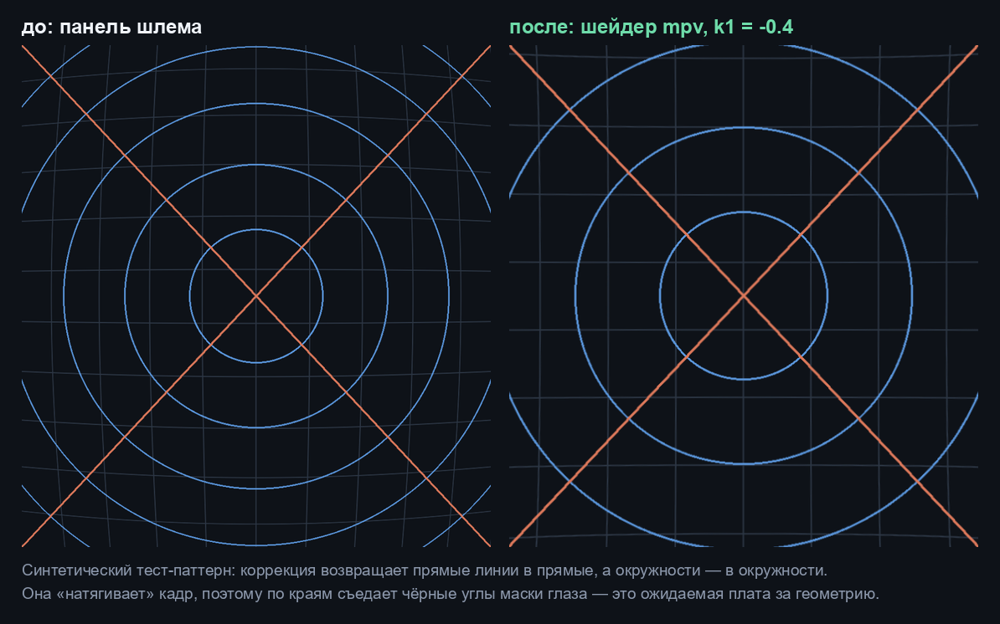
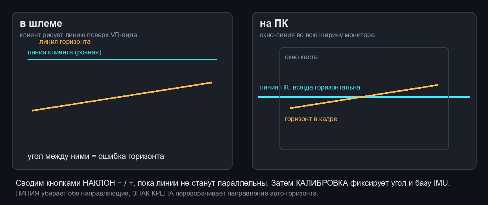

# Quest 3 Cast

Каст шлема **Meta Quest 3** на ПК по Wi-Fi через Android Debug Bridge: без приложения Meta Horizon,
без аккаунта, без облака и без кастинга — картинку забирает `scrcpy`, показывает `mpv`, а геометрию
(дисторсия линзы и наклон панели) правит GPU-шейдер. Управление — оконное приложение для Windows и
Android-клиент в шлеме, по локальной сети.


## Зачем

Штатный кастинг Quest капризен, привязан к аккаунту и не отдаёт картинку в удобном виде: он либо
идёт в браузер, либо требует сервисов Meta. При этом сам шлем — обычный Android с включённой
отладкой, а `scrcpy` умеет снимать панель целиком. Проект доводит эту идею до рабочего состояния:

- **видно то, что видит шлем** — панель целиком или один глаз;
- **картинка геометрически правильная** — снята не «как есть», а с обратной дисторсией линзы и
  компенсацией наклона панели;
- **горизонт держится сам** — по IMU шлема, без ручной подстройки на каждый поворот головы;
- **низкая нагрузка** — аппаратное декодирование и шейдер на GPU: около **0.17 ядра** против
  **≈2.4 ядра** у чисто программного пути;
- **живёт само** — супервизор поднимает конвейер после сбоев, перезагружает залипший кадр и
  переподключает шлем после перезагрузки.

## Что умеет

| Возможность | Как сделано |
|---|---|
| Захват | `scrcpy --display-id=0`, панель 4128×2208, кроп глаза 2064×2208, 60 fps |
| Показ | `mpv` + `d3d11va` + GPU-шейдер (fallback на `ffplay`, если mpv нет) |
| Геометрия | коррекция линзы `k1/k2`, поворот и наклон кадра |
| Горизонт | замер по картинке (калибровка) + живое сопровождение по IMU шлема |
| Сведение горизонта | линия в шлеме и линия на ПК: сводятся глазами, угол фиксируется кнопкой |
| Звук | с микрофона шлема, **по умолчанию выключен**; системный звук Android на шлеме недоступен |
| HUD | прозрачная плашка в углу: fps, поток, CPU, RAM, GPU, пинг, состояние микрофона |
| Управление | окно Windows (кнопки, выбор глаза) + Android-клиент по TCP/JSON |
| Живучесть | watchdog кадра, backoff перезапусков, переподключение adb, опциональная перезагрузка по расписанию |

## Как это работает

```
┌──────────── шлем Quest 3 ────────────┐        ┌──────────────── ПК ─────────────────┐
│ vrcompositor рисует глаз в панель    │  adb   │ scrcpy -server  →  H.264 в pipe     │
│ панель уже предыскажена под линзу    │ ─────► │        │                            │
│                                      │ Wi-Fi  │        ▼                            │
│ Android-клиент: кнопки + IMU 800 Гц  │ ─────► │ quest3-pump.ps1  →  mpv (d3d11va)   │
└──────────────────────────────────────┘  TCP   │        │              + шейдер      │
                                                │        ▼                            │
                                                │  окно каста + HUD (WinForms)        │
                                                │  QuestCast.exe: UI, LAN-сервер      │
                                                └─────────────────────────────────────┘
```

Ключевой момент: панель шлема содержит кадр, **уже предыскажённый композитором** под линзу. Если
показывать его плоско, мир выглядит «бочкой». Поэтому в конце конвейера стоит обратное преобразование
(пинкушин), а наклон панели внутри корпуса компенсируется поворотом кадра.



## Требования

- Windows 10/11, PowerShell 5.1 (встроенный).
- `adb` (platform-tools), `scrcpy` 2.x/5.x, `mpv`, `ffmpeg` — в `PATH` или в winget-каталоге:

  ```powershell
  winget install Google.PlatformTools
  winget install Genymobile.scrcpy
  winget install shinchiro.mpv
  winget install Gyan.FFmpeg
  ```

- Шлем: включённый режим разработчика и разрешённая отладка по USB (для первого подключения нужен
  кабель, дальше — Wi-Fi).
- Для сборки приложения: .NET SDK 10, для Android-клиента: JDK 17+ и Android SDK (platform 34).

Первый запуск отладки требует аккаунта Meta (Developer Mode включается в приложении Horizon) —
это единственное место, где аккаунт нужен. Дальше всё работает локально.

## Быстрый старт

1. Подключить шлем по USB, разрешить отладку в шлеме, перевести adb на TCP:

   ```powershell
   adb devices
   adb tcpip 5555
   adb connect 192.168.1.100:5555     # IP шлема: Настройки → Wi-Fi → сеть
   ```

   `adb tcpip 5555` сбрасывается после перезагрузки шлема — тогда снова по кабелю.

2. Разложить движок и поправить конфиг:

   ```powershell
   cd engine
   copy config.example.json config.json
   notepad config.json                 # "ip" — адрес шлема
   ```

3. Запустить каст:

   ```powershell
   .\quest3-cast.cmd start
   .\quest3-cast.cmd status
   ```

4. При желании — окно с кнопками, HUD и Android-клиент: см. [app/README.md](app/README.md).

Команды движка: `start`, `stop`, `status`, `install` (автозапуск при входе), `uninstall`,
`shortcut` (ярлык на рабочем столе), `calibrate` (замер наклона горизонта).

## Приложение QuestCast

Окно Windows с состоянием и кнопками: СТАРТ, СТОП, ПЕРЕЗАПУСК, МИКРОФОН, ЛИНЗА, КАЛИБРОВКА,
ОТКРЫТЬ ПОРТ, АВТО-ГОРИЗОНТ, ЗНАК КРЕНА, ЛИНИЯ, НАКЛОН −/+ и выбор глаза (левый / правый / оба).
Приложение не дублирует движок: оно управляет теми же скриптами и держит LAN-сервер, к которому
подключается клиент из шлема.

Подробности, протокол и сборка — [app/README.md](app/README.md).

## Android-клиент

Тот же набор кнопок в шлеме, плоской панелью: СТАРТ, СТОП, ПЕРЕЗАПУСК, МИК, ЛИНЗА, ГОРИЗОНТ,
КАЛИБРОВКА, ЛИНИЯ, НАКЛОН −/+, выбор глаза. Плюс чтение IMU для авто-горизонта, своя линия горизонта
(рисуется поверх VR-вида) и индикатор подключения. Ставится через `adb install`, при первом запуске —
адрес ПК, порт и токен.

Сборка: `cd android && gradlew.bat assembleDebug` (нужен `ANDROID_HOME` или файл
`android/local.properties` со строкой `sdk.dir=...`).

Порт по умолчанию 47801. Если Windows не пускает входящие (оба профиля сети «Общедоступная»),
один раз запустите `app\allow-firewall.cmd` от администратора или кнопку **ОТКРЫТЬ ПОРТ**.
Без правила есть обходной путь — туннель поверх adb:

```powershell
adb reverse tcp:47801 tcp:47801
```

и в клиенте адрес `127.0.0.1`.

## Геометрия и горизонт

**Линза.** `k1` работает так же, как одноимённый параметр `lenscorrection` в ffmpeg: радиус
нормирован на угол кадра, поэтому коэффициент переносится между CPU- и GPU-путём. Рабочее значение
для Quest 3 — `-0.4`; больше по модулю — перебор, меньше — остаётся бочка.

**Наклон.** Он состоит из двух слагаемых: постоянный наклон панели в корпусе и крен шлема в мире.
`calibrate` меряет первое по картинке (6 секунд записи → градиентный анализ → угол), а второе
берётся из IMU. Поворот идёт с расширением кадра, поэтому по краям появляются чёрные клинья — это
плата за то, что кадр остаётся прямоугольным.

**Авто-горизонт.** У обычного 2D-приложения в шлеме стандартные датчики Android недоступны, зато
читается вендорный `oculus.sensor.hmd_imu.2`: ~800 Гц, вектор гравитации в `values[1..3]`. Из него
считается крен `atan2(x, -y)`, клиент отправляет его 4 раза в секунду, движок обновляет шейдер, а
pump подменяет его в работающем mpv по IPC — **без перезапуска конвейера**. База (постоянный наклон)
запоминается в момент `КАЛИБРОВКА`, поэтому дальше компенсируется только крен головы.

**Сведение двух линий.** IMU знает изменение крена, но не абсолютную вертикаль: какая из осей мира
сейчас «низ», он сам по себе не скажет. Поэтому есть ручное сведение — две линии, которые оператор
совмещает глазами:

1. в шлеме клиент рисует свою горизонтальную линию (поверх VR-вида, на фиксированном угле) —
   это то, что человек видит вокруг себя;
2. на ПК движок рисует линию в экранных координатах, поперёк всего монитора, — она всегда
   строго горизонтальна, потому что не зависит ни от шлема, ни от шейдера;
3. кнопками **НАКЛОН −/+** угол поворота кадра меняется, пока линия на стриме не встанет
   параллельно линии на ПК; **ЗНАК КРЕНА** переворачивает направление, если авто-горизонт уводит
   не в ту сторону; **ЛИНИЯ** убирает обе направляющие;
4. найденный угол применяется как база (`TILT` в конфиге) и дальше удерживается авто-горизонтом.

Кнопка **ЛЕВЫЙ / ПРАВЫЙ / ОБА** выбирает, какой глаз смотреть: для сведения удобнее один глаз —
у панели искажение симметрично, и линия одного глаза не спорит с линией другого.



## Протокол управления

TCP, порт 47801, по одному JSON в строке. Сервер сам присылает состояние раз в секунду.

```
← {"type":"hello","need":"token","app":"QuestCast","proto":1}
→ {"type":"auth","token":"<ваш токен>"}
← {"type":"auth","ok":true}
→ {"type":"cmd","cmd":"start"}                      // start | stop | restart | state
→ {"type":"cmd","cmd":"eye","value":"left"}         // left | right | both
→ {"type":"cmd","cmd":"mic","value":true}
→ {"type":"cmd","cmd":"lens","value":false}
→ {"type":"cmd","cmd":"calibrate"}
→ {"type":"cmd","cmd":"autolevel","value":true}
→ {"type":"cmd","cmd":"tiltsign","value":true}
→ {"type":"cmd","cmd":"guide","value":true}          // обе направляющие: в шлеме и на ПК
→ {"type":"cmd","cmd":"nudge","value":-0.5}          // поворот кадра на ±0.5° (сведение линий)
→ {"type":"tilt","roll":-1.1,"pitch":4.5}           // клиент шлема, 4 Гц
← {"type":"ack","cmd":"start","ok":true,"message":"started"}
← {"type":"state","state":{"running":true,"fps":60,"eye":"left","mic":false,...}}
```

## Производительность

Замеры на Ryzen AI Z2 Extreme (16 потоков), 1440p60, Wi-Fi adb, шлем на столе:

| Путь | CPU (ядер) | fps | Комментарий |
|---|---|---|---|
| `ffplay` + `lenscorrection` | ≈ 2.4 | ~51 | программный декод и программная линза |
| `mpv` + `d3d11va` + шейдер | **≈ 0.17** | 60 | кадр не покидает GPU |

Восстановление после сбоев (замеры `engine/test-stability.ps1`): kill scrcpy ≈ 7 с, kill плеера
≈ 7 с, kill HUD ≈ 2 с, разрыв adb ≈ 15 с, залипший кадр ≈ 26 с.

## Ограничения

- **Звук приложений шлема не захватывается**: `--audio-source=output` на Quest 3 падает, доступен
  только микрофон (`mic`), и он по умолчанию выключен.
- **Nvidia/Intel не проверялись**: путь рассчитан на `d3d11va`; на других GPU работоспособность
  зависит от драйвера.
- **Геометрия приблизительная**: `k1` — подбор под конкретную ревизию линзы, точность наклона
  ±1–2°. Панель может отличаться между партиями шлемов.
- **IMU даёт крен и тангаж, но не рыскание**; пока шлем лежит на столе, авто-горизонт выравнивает
  крен стола, а не головы.
- Кнопка «ОТКРЫТЬ ПОРТ» требует UAC; без правила LAN-клиент не подключится.
- Каст привязан к отладке: выключенный режим разработчика или отозванное разрешение ломают всё.

## Структура репозитория

```
engine/     движок каста на PowerShell: scrcpy → pump → mpv, HUD, калибровка, супервизор
app/        QuestCast — окно Windows (WPF, .NET 10), LAN-сервер, сборка exe
android/    QuestCastClient — клиент для шлема (Java, без внешних зависимостей)
docs/       скриншоты и планы
```

`engine/README.md` описывает конфиг, команды и внутренности супервизора, `app/README.md` — приложение,
протокол и сборку.

## Куда дальше

Этот репозиторий осознанно решает одну задачу — показать панель шлема на ПК с правильной
геометрией. Стример PCVR-класса (в духе Virtual Desktop: два глаза, свой транспорт, SSW,
виртуальные экраны) — отдельный конвейер, потому что ADB отдаёт готовый кадр панели и не даёт
ни позы, ни стерео, ни глубины.

План такого стримера, с этапами, приёмкой и рисками: [docs/ROADMAP.md](docs/ROADMAP.md).


## Лицензия

MIT — см. [LICENSE](LICENSE).
